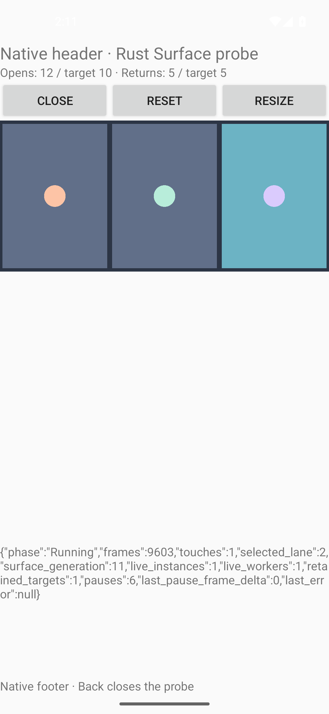
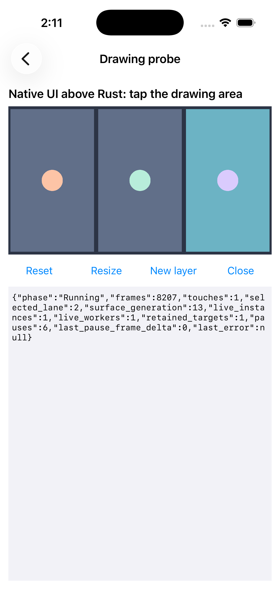

# 最小のネイティブ埋め込み検証

同じRustコアとwgpu描画器を、両OSのネイティブUIの一部で動かせた。ここでは図形プローブだけを検証し、レースや通信の成功とは扱わない。実機・性能は未確認。

## 実行条件

2026-10-24 JST。実装コミット`5f34102`をビルドした。後続の共有契約・レビュー文書変更は実行コードを変更しない。

| 対象 | Android | iOS |
|---|---|---|
| 実行環境 | 専用Pixel 5定義のarm64 Emulator / API 35 | 専用iPhone 17 Simulator / iOS 26.5 |
| 専用ID | `emulator-5630` / `RustMobileGameLab_API35_20261024` | `06E9B566-FCC7-4A9B-9A0D-046B9A28D126` |
| アプリ | `lab.rustmobile` | `lab.rustmobile.ios` |
| ビルド | Debug APK + Rust release最適化 | Debug app + Rust debug |
| 描画環境 | `-gpu swiftshader`で起動。wgpuの選択backendは未取得 | CAMetalLayer/Metal経路。GPU型番は未取得 |
| ネイティブ領域 | 上のヘッダー/操作、下の状態/フッター | 上のヘッダー、下の操作/状態 |

Androidの専用AVDは既定データ領域に空き容量が足りず、公式`-partition-size 2048`で2GBに設定して起動した。既存のAVD/Simulatorは変更しない。

## 実行した検証

両OSを明示指定したMobile MCPのUI操作と要素取得で実行し、端末上のRust状態JSONを読み取った。入力はモバイルUIへの実際のタップであり、Rustの入力関数をテストから直接呼ぶ方法とは区別する。

| シナリオ | Android | iOS | 観測 |
|---|---|---|---|
| 部分描画・右レーン入力 | 成功 | 成功 | touches=1、selected_lane=2、上下のネイティブUIと図形を目視 |
| ネイティブReset | 成功 | 成功 | touchesを増やさずselected_lane=null（修正前の初期縦断でも確認） |
| 開閉10回 | 成功 | 成功 | 閉じるたびにロビー/Closed表示へ戻り、再開ごとにRust所有数を確認 |
| 背景復帰5回 | 成功 | 成功 | HOMEで離脱し同じアプリを再表示。接続世代が進み状態と描画が復帰 |
| 停止中の描画提出増分 | 各回0 | 各回0 | pause開始/終了時に同じRustカウンターを比較 |
| Resizeと再生成後入力 | 成功 | 成功 | iOSはNew layerも実施。再生成後の右レーン入力を受理 |
| 所有数の増加 | 観測なし | 観測なし | 各再開時のlive_instances/live_workers/retained_targetsが各1 |
| 解放順 | 確認 | 確認 | 同世代のsurface_dropped→native_reference_releasedをログで確認 |

修正前の正常系に加え、取得待ちの修正後にも上記の10回/5回/再生成を再実施した。修正後の全観測値は[実行記録](evidence/native-mobile-smoke.json)。保持数はこのRust実装が所有する参照数であり、OS/GPU全体のメモリ使用量ではない。

`frames`と`last_pause_frame_delta`はqueue.submit/presentへ提出した回数。画面の実提示間隔、FPS、CPU時間や実機性能を測った数値ではない。

## 見つけて修正した問題

- iOS Simulatorが許すシェーダー変数上限15に対し、wgpuの既定要求が16で初期化できなかった。図形に必要な低い要求値を明示し、両OSの実描画で確認。
- 独立レビューで、Metalの描画先取得待ち中にUIの停止用gateを保持する問題を発見。取得と準備をgate外へ分け、submit/present前に世代・paused・destroyedを再検査。Metalの取得timeoutもconfigure毎に有効化しgetterで確認する。
- 待機を意図的に保留する回帰テストで、pause/detach/destroyの完了と、遅れて得たフレームをsubmitせずgate外で破棄することを検証した。長いsleepには依存しない。

[重点レビューと修正確認](reviews/native-boundary.md)。Rustはcore 3件、描画4件、runtime 8件を確認。Androidホストの3単体テストとlint、両OSアプリのビルドも成功。

## 画像

以下は専用端末上で実際に起動したアプリの画像。生成画像ではない。

| Android | iOS |
|---|---|
|  |  |

## 未確認と次の段階

実機、5分性能/メモリ推移、実際のGPU/OSハング、実Surface/Device Lostの故障注入、モバイルでの初期化中の高速Close、レース/通信/投票、SDK生成物を消費するホストは未確認。正常系の再生成とソース・境界テストを、これらの成功へ読み替えない。
次は独立した純粋コアのレースを接続し、オフライン一巡を観測してから通信を接続する。親Issueは開いたままにする。
